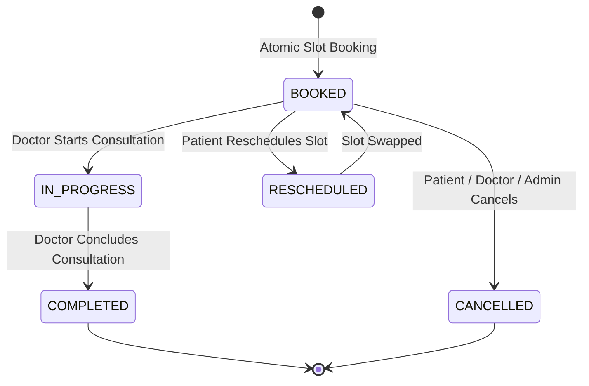
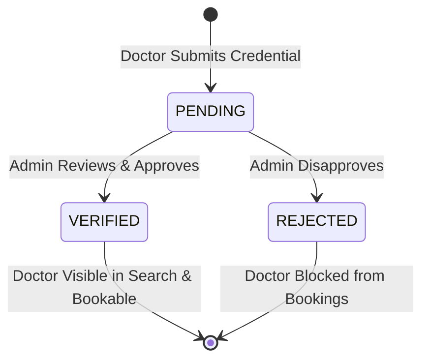

# Architecture & System Design: CarePath Telemedicine Platform

## 1. System Overview

**CarePath** is an enterprise-grade telemedicine application inspired by classical Ayurvedic clinical workflows and modern healthcare systems. The application is built as a **Modular Monolith** prioritizing strict transactional consistency, high concurrency safeguards, data minimization, role-based and object-level access control, and complete auditability.

```mermaid
flowchart TB
  subgraph Client [Browser Client Layer]
    ReactApp[React 18 Single Page App<br/>(Amrutam Earth Aesthetic)]
    PersonaSwitch[Persona Switcher & Auth State]
  end

  subgraph Gateway [API Layer - Express.js]
    Router[REST Router /api/v1]
    CorrMW[Correlation ID & Metrics Middleware]
    AuthMW[JWT & Active User Middleware]
    RateLimit[Express Rate Limiters]
  end

  subgraph Modules [Backend Domain Modules]
    AuthDomain[Identity & Auth Service]
    DoctorDomain[Doctor Directory & Availability]
    BookingDomain[Booking, Rescheduling & Cancellation]
    ClinicalDomain[Consultation & Clinical Notes Versioning]
    RxDomain[Prescription & Amendment Engine]
    ConsentDomain[Consent & Privacy Registry]
    NotifDomain[In-App Notification Center]
    AdminDomain[Analytics & Governance]
  end

  subgraph Persistence [Data Layer - PostgreSQL 16]
    PrismaORM[Prisma Client 6.2.1]
    PG[(PostgreSQL Database<br/>Serializable Transactions)]
  end

  Client -->|HTTPS / REST API| Gateway
  Gateway --> Modules
  Modules --> PrismaORM
  PrismaORM --> PG
```

---

## 2. Domain Separation of Concerns

The backend is cleanly decomposed into domain services:

1. **Identity & Authentication Domain:**
   - Public patient registration enforces `role: PATIENT` and seeds required consent declarations.
   - Argon2id password hashing with custom memory cost parameters.
   - Dual-token session strategy: 15-minute access token (JWT), 14-day rotated refresh token (stored as SHA-256 HMAC digest).
   - Instant token revocation on logout or administrative account suspension.

2. **Practitioner & Availability Domain:**
   - Normalized `Specialty` catalog and many-to-many `DoctorSpecialty` relations.
   - Doctor qualification, experience, fee display, language, and mode tracking.
   - Multi-tier availability: single slots, weekly recurring `AvailabilityRule`, and `DoctorBlockedPeriod` (vacation/leave).
   - Credential verification pipeline (`DoctorCredential`) reviewed by administrators.

3. **Booking & Concurrency Domain:**
   - Concurrency Protection: PostgreSQL `Serializable` transaction isolation combined with atomic row-level conditional updates (`UPDATE ... WHERE status = 'AVAILABLE' RETURNING id`).
   - Idempotency Engine: Required `Idempotency-Key` header with request body fingerprinting. Guarantees that duplicate requests replay cached responses without duplicate writes, and detects payload conflicts.
   - Atomic Rescheduling: Swaps slots within a single transaction, frees prior slot, reserves replacement, logs `AppointmentStatusHistory`, and notifies both participants.

4. **Clinical & Consultation Lifecycle Domain:**
   - Strict State Machine: `BOOKED` -> `IN_PROGRESS` (with `startedAt`) -> `COMPLETED` (with `completedAt`).
   - Immutable Note Versioning: Clinical note edits archive prior versions in `ConsultationNoteHistory` with author attribution and increment version counters.
   - Prescription Amendment Workflow: Multi-item prescriptions with dosage, frequency, duration, route, and instructions. Amendments generate new versions and persist reason records in `PrescriptionAmendment`.

5. **Notification Domain:**
   - PostgreSQL-backed persistent in-app notifications.
   - Real-time unread counter, single-notification read marking, and bulk read actions.

6. **Governance & Administrative Domain:**
   - Verification review queue for incoming practitioner applications.
   - Real database aggregate analytics (no hardcoded counters).
   - User account activation and suspension with session revocation.
   - Immutable audit trail capturing actor, action, resource, correlation ID, and timestamps.

---

## 3. Concurrency & Transaction Boundaries

### 3.1 Slot Claim Concurrency Guard
When multiple concurrent requests attempt to reserve the same slot, application-level checks are insufficient. CarePath combines two layers of protection:
1. **Conditional Atomic Write:**
   ```sql
   UPDATE "AvailabilitySlot"
   SET "status" = 'BOOKED'
   WHERE "id" = $1 AND "status" = 'AVAILABLE'
   RETURNING "id", "doctorId";
   ```
   If another transaction claims the slot first, the query affects 0 rows, triggering immediate transaction rollback with an HTTP 409 conflict.
2. **PostgreSQL Serializable Isolation:** Guarantees serializability under concurrent scheduling and eliminates race conditions. Automated tests submit 20 parallel concurrent booking requests for a single slot, confirming that exactly 1 booking succeeds while 19 are safely rejected.

### 3.2 Idempotency Contract
- **Key Header:** `Idempotency-Key: <UUID>`
- **Scope:** Operation-specific (e.g., `appointment.create`)
- **Fingerprint:** SHA-256 hash of normalized request body
- **Replay Behavior:** Identical key + identical payload returns HTTP 200 with saved appointment data (`replay: true`). Identical key + different payload returns HTTP 409 Conflict.

---

## 4. State Machines

### 4.1 Appointment State Transitions


### 4.2 Doctor Credentialing Workflow


---

## 5. Security & Access Control Matrix

| Operation | Patient | Doctor | Administrator |
|---|---|---|---|
| Search Public Doctors | Yes | Yes | Yes |
| View Available Slots | Yes | Yes | Yes |
| Book Appointment | Yes (own) | No | No |
| Reschedule Appointment | Yes (own) | No | Yes (override) |
| Cancel Appointment | Yes (own) | Yes (own assigned) | Yes (override) |
| Manage Availability | No | Yes (own profile) | Override |
| Start/Complete Consultation | No | Yes (assigned doctor) | No clinical authority |
| View Clinical Notes | Own records | Assigned patient | No clinical access |
| Issue / Amend Prescriptions | No | Assigned patient | No clinical access |
| Review Doctor Credentials | No | No | Yes |
| Suspend User Account | No | No | Yes |
| View System Audit Trail | No | No | Yes |
