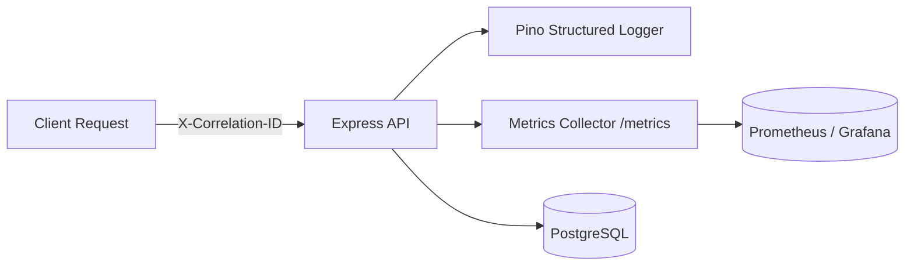

# Observability & Monitoring Guide

## 1. Monitoring Architecture

CarePath exposes structured JSON logging, correlation tracking, and Prometheus-compatible metrics out of the box.

---

## 2. Key Metrics & Endpoints

### 2.1 Prometheus Metrics Endpoint
- **URL:** `GET /metrics`
- **Format:** Prometheus text format version 0.0.4

Exposed Metrics:
- `http_requests_total{method, path, status}`: Total count of processed HTTP requests partitioned by HTTP method, normalized endpoint path, and HTTP status code.
- `booking_attempts_total`: Total number of appointment booking attempts initiated.
- `booking_success_total`: Number of appointment bookings successfully committed.
- `booking_conflicts_total`: Number of slot booking contention conflicts (HTTP 409) caught.
- `idempotency_replays_total`: Number of idempotent cached responses replayed.

### 2.2 Health & Readiness Endpoints
- `GET /health`: Liveness probe returning `{ "status": "ok" }`.
- `GET /ready`: Readiness probe executing `SELECT 1` against PostgreSQL, returning `{ "status": "ready" }`.

---

## 3. Correlation Tracking

Every request through the system is assigned a unique correlation ID via `X-Correlation-ID` (or `X-Request-ID`). If the client passes a correlation ID in the request header, that ID is preserved across all database operations, audit logs, and response headers.

---

## 4. Troubleshooting Workflow

### High Booking Conflict Rate
1. Check `/metrics` for `booking_conflicts_total`.
2. Review audit logs (`GET /api/v1/admin/audit-logs?limit=50`) filtering for action `appointment.booked` or conflict outcomes.
3. Check PostgreSQL connection pool saturation and active lock duration.

### Intermittent 401 Unauthorized
1. Check token expiration (`ACCESS_TOKEN_TTL`, default 15m).
2. Inspect if client is hitting `/api/v1/auth/refresh` with a valid refresh token.
3. Verify if target user has been suspended (`isActive: false`) in administrative user management.
